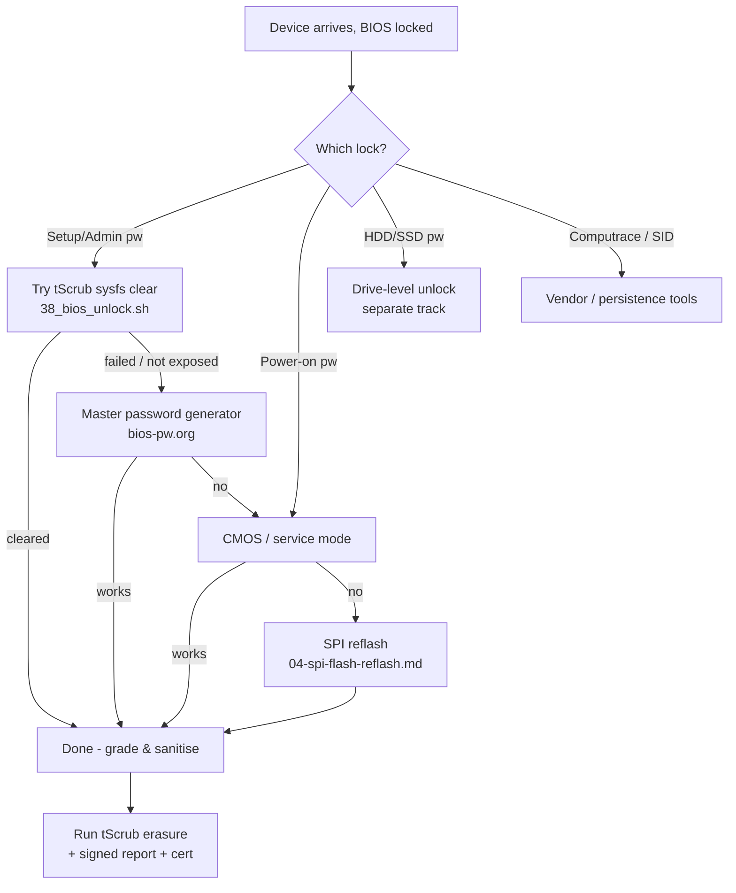

# BIOS Unlock — ITAD Salvage Research

Research and runbooks for **unlocking BIOS-locked laptops** that have entered the ITAD
process (ownership legally transferred, original passwords lost) so they can be graded,
sanitised and resold instead of landfilled.

> **Scope / legality.** Everything in this folder assumes the device is legally owned by
> the ITAD company (purchase/donation paperwork in hand). Keep the chain-of-custody /
> proof-of-ownership document with every unit — several vendor unlock paths (Dell, HP,
> Apple) require it. Never use these techniques on a device you do not own.

## Relationship to existing tScrub code

| Piece | What it does | Where |
|---|---|---|
| BIOS lock **detection** | 4-layer cascade (sysfs `firmware_attributes` → `hp-wmi`/`thinkpad_acpi` → SMBIOS Type 24) | `research/bios-lock/bios-lock.sh` |
| Appliance detection | `bios::detect` runs at boot, emits `BIOSLock`/`BIOSLockMethod` in the report | `product/src/36_bios.sh` |
| Remote unlock (sysfs) | Dashboard-queued clear of the admin password via `firmware_attributes` (Dell/Lenovo, HP `hp-wmi`) | `product/src/38_bios_unlock.sh` |

This folder extends that with the **hardware** side: what to do when the sysfs/software
path can't clear the lock — service mode, CMOS, and SPI/EC reflash.

## Folder index

1. [`01-overview-and-legal.md`](01-overview-and-legal.md) — lock taxonomy, what we're
   actually fighting, and the compliance/ownership framing.
2. [`02-non-invasive-methods.md`](02-non-invasive-methods.md) — master passwords,
   vendor tools, and tScrub's own sysfs clear. Always try these first.
3. [`03-cmos-and-service-mode.md`](03-cmos-and-service-mode.md) — CMOS battery, jumpers,
   and vendor service-mode tricks.
4. [`04-spi-flash-reflash.md`](04-spi-flash-reflash.md) — **the core ask**: dumping,
   patching and reflashing the firmware SPI flash (and EC) with a CH341A + `flashrom`.
5. [`05-vendor-matrix.md`](05-vendor-matrix.md) — per-vendor cheat sheet of what works.
6. [`06-fleet-plan.md`](06-fleet-plan.md) — **the actual fleet** (65 units, 61 locked)
   from the dashboard DB, with a per-model priority plan.
7. [`07-removal-techniques.md`](07-removal-techniques.md) — **model-specific removal
   procedures**: HP i-code hash, HP SMC, Lenovo SVP, Fujitsu, and the SPI fallback.
8. [`08-empirical-findings.md`](08-empirical-findings.md) — **verified on live hardware**
   (HP 830 G5 sysfs clear is dead; remote clear is Dell/Lenovo-only).
9. [`09-inhouse-spi-service.md`](09-inhouse-spi-service.md) — **run it like the eBay
   sellers**: SPI bench as the primary plan, SMC demoted to fallback, plus the
   buy-one-unlock-and-diff-the-patch bootstrap.
10. [`10-hp-830g5-spi-sop.md`](10-hp-830g5-spi-sop.md) — **step-by-step SPI unlock for
    the dominant model**: build list, dump→patch→reflash, and identity-preservation
    checks (serial/UUID/MAC/FeatureByte/Windows key).
11. [`11-830g5-dump-anatomy.md`](11-830g5-dump-anatomy.md) — **anatomy of the first real
    dump**: 32 MB W25Q256, Intel region map, AMI Aptio (not Insyde), hashed password in
    the "Setup" NVRAM variable, and the HP MUD identity region to preserve.
12. [`12-bench-setup-windows.md`](12-bench-setup-windows.md) — **Windows 11 bench
    setup**: Zadig WinUSB driver, NeoProgrammer, UEFITool/AMIBCP/HxD, and the
    clip-vs-desolder decision.
13. [`13-remote-unlock-robustness.md`](13-remote-unlock-robustness.md) — **remote
    unlock robustness** (shipped v1.11.3): base64 password transport, dispatched
    TTL + requeue, password purge on supersede/stale, slot priority and re-verify.
14. [`14-firmware-attributes-interface.md`](14-firmware-attributes-interface.md) —
    **the firmware-attributes interface, and why HP said "Not supported"**: the
    orphaned class device and the kernel initcall-ordering root cause, the patch
    that fixes Dell/Lenovo, HP's `authentication/` + `is_enabled` layout, and the
    live fleet re-verification (including the `dmesg` evidence that the BIOS
    rejects hp-bioscfg's write command).
15. [`15-clearing-with-a-known-password.md`](15-clearing-with-a-known-password.md) —
    **can tScrub remove the password when the operator supplies the correct one?**
    Dell ✅ and Lenovo ✅ do it in the driver's `new_password_store`; HP ❌ cannot
    from Linux (no sysfs entry point, `new_password` is a dead end even upstream,
    and the firmware refuses the set command). Includes HP's BIOS-lockout warning
    and the vendor-supported route (CMSL `Clear-HPBIOSSetupPassword`, documented
    to run in WinPE).
16. [`16-wmi-wire-format-and-status-codes.md`](16-wmi-wire-format-and-status-codes.md) —
    **the HP WMI wire format, read out of the firmware's own AML** (ACPI tables
    pulled off the live appliance and disassembled with `iasl`): `WMBS(method_id=1)`
    → `WSBS` → a length-prefixed-element buffer handed to the BIOS mailbox, the
    exact element layout (name, value, `"<utf-16/>"+password`), the status codes
    (0/4/5/6), and HP's own mapping of **`0x06` → "attempt to access BIOS features
    unsuccessfully"**. Shows the Linux driver frames the request correctly — it is
    the *credential* that is refused — corrects doc 15, and gives the ~5-line
    driver patch that would make an HP clear possible with a known password.
17. [`17-out-of-the-box-techniques.md`](17-out-of-the-box-techniques.md) — **what else
    can reach the interface**: module loading, `/dev/mem`, the WMI userspace method
    file that no longer exists in 6.18, and a ranked table of avenues. Its capability
    survey and recommended route (our own module) were confirmed in practice; two of
    its hypotheses were corrected by 18.
18. [`18-live-wmi-probing-results.md`](18-live-wmi-probing-results.md) — **live
    probing, with the firmware answering**: builds and loads an out-of-tree module
    (`hpraw/`) that calls `WMBS` with arbitrary buffers and reads the status codes
    back. Corrects the status-code reading `0x04`/`0x05`/`0x06`, shows method 2 and
    the legacy `SECU` interface are dead ends, proves `Setup Password` is a name the
    BIOS recognises and that an empty new value is accepted, and then
    **clears a real HP BIOS Setup Password from Linux on `192.168.0.171`** (three
    elements: `[Setup Password][<utf-16/>][<utf-16/>hpinvent]`) — **confirmed by
    reboot**. Also records the honest caveat that a `0x00` status alone does not
    prove a value was stored.
19. [`19-shipping-plan-wmi-clear.md`](19-shipping-plan-wmi-clear.md) — **the
    implementation plan** for turning that into a product feature: a narrow
    write-only kernel module (hardcoded GUID/method, validated element sizes, no
    password logging) plus a second strategy in `38_bios_unlock.sh`, the mandatory
    corroboration step before claiming success, the risk table (HP lockout,
    over-claiming, unload quirk, model/slot coverage) and the bench test checklist.
20. [`20-insyde-setup-password-state.md`](20-insyde-setup-password-state.md) — **the
    Insyde setup-password state on older/consumer HP**: why the ENVY m6 and the other
    `UNKNOWN` machines expose no SMBIOS Type 24, the `UserCred` UEFI variable
    fingerprint (`AdminPW` record present/absent) that works on HP business firmware,
    and why it cannot rescue the consumer/Insyde `UNKNOWN` class.
21. [`21-hardware-bom.md`](21-hardware-bom.md) — **fleet-weighted hardware BOM for the
    SPI reflash bench**: the top four models are 87% of locked units, and the 830 G5 /
    820 G3 / 650 G4 are **WSON8** (not SOP8), so the bench needs WSON8 pogo probes +
    hot air, not a SOIC8-clip-only kit. Includes phase 0 survey, phase 1 starter bench,
    phase 2 production hardening, quantities, costs and a per-model survey worksheet.
22. [`22-2026-trends.md`](22-2026-trends.md) — **the 2025–2026 tool and method changes**:
    WSON8 in-circuit is mainstream, the 830 G5 has a second 16 MB SPI chip (RCUnlocker),
    open-source patchers (`dellpwn`, `8FC8_Patcher`, `libv/hp_bios_passwd_erase`), the
    T56 discontinuation / T76 replacement, and the flashrom 1.7/1.8 toolchain.
23. [`23-reddit-sweep.md`](23-reddit-sweep.md) — **the Reddit sweep**: community consensus
    on WSON8 (pogo/solder-wire, never a SOIC8 clip), the post-2018 HP vendor dead end,
    RCUnlocker/HPUnlocker reports, the CH341A 5 V warning, and the new HP Sure Start
    EC pin-short method that needs a sacrificial-unit test.
24. [`24-technique-deep-dive.md`](24-technique-deep-dive.md) — **second-pass deep dive**:
    the Sure Start EC pin-short in full (original source, confirmed/failed models, live
    vs cold variant, brick/Endpoint Security risks), the 830 G5 `25Q256JV` + `25Q128JV`
    chip map and the conflicting RCUnlocker/Bios-Fix reports with a test matrix, the
    Lenovo T14/X13 **MEC1663** EC route (Auto-Patcher, SVOD, JTAG pin short), and the
    WSON8 pogo best practices (measure pin 8 VCC, proper probe, 8 MHz, desolder if
    unstable).
25. [`25-github-sweep-and-dump-tests.md`](25-github-sweep-and-dump-tests.md) — **GitHub
    sweep plus tests against our own dump**: `libv/hp_bios_passwd_erase` and
    `R3n5k1/dellpwn` are the two useful open-source HP tools, but our 32 MB dump has
    **0** `HpPassphraseStructureVariable` markers, 0 `$VSS`/`UserCred`, and 4
    `NvramActiveRegn` blocks that do not match `hp_erase`'s expected subheader. The
    tools reject the compressed BIOS image, which points the next test firmly at the
    **16 MB EC BIOS**. Includes the exact dump-scan results, macOS build workaround,
    legacy tools to avoid, and the revised open-source-first test matrix.
26. [`26-tooling-2026.md`](26-tooling-2026.md) — **November 2026 tooling refresh**:
    current programmer prices (T48 primary ~£50–100, CH341A £5–8, T76 £150–250,
    EZP2023+ mid-tier), the software stack pinned (flashrom v1.8, NeoProgrammer over
    AsProgrammer, Xgpro), the full password-patcher list with links (RCUnlocker,
    dellpwn, HPUnlocker, Lenovo Auto-Patcher ≤8th gen, H2O unlocker), and the
    clip-on survey — the fleet is WSON8-first, so the WSON8 5x6/6x8 pogo probes are
    the critical buy, now commodity on AliExpress/Amazon, with SOIC8 clip (Pomona
    5250) and 1.8 V adapter as supporting kit.
27. [`27-nvram-blank-unlock.md`](27-nvram-blank-unlock.md) — **830 G5 unlocked via
    main BIOS only (no EC desolder)**: decoded the F1 COMPUTER video
    (`jjEv_JWXWNE`) — its "unlocked" file is a different unit whose NVRAM
    authenticated variable store at `0x01AF6048` is wiped (header kept, body FF).
    Our locked dump's same store holds `Settings` (2,053 B, carries the admin
    password hash) + PhysicalPresence vars. Patch = blank the store body;
    `BINs/830_G5.unlocked.bin` is our own dump with exactly that, byte-identical
    to the video's store region, identity (serial/UUID/MAC) untouched. Flash-back
    procedure and EC-restore fallback included.

## Decision tree

## Golden rules

1. **Non-invasive first.** Software > service mode > CMOS > SPI reflash. Every step down
   adds risk and labour.
2. **Always back up.** Before *any* SPI work, dump the flash **twice** and verify the
   SHA-256s match. A bad dump is a bricked board.
3. **Patch, don't clone.** Never flash another unit's dump verbatim — you'll clone its
   serial / MAC / Windows key / ME region. Patch the unit's own dump in-place.
4. **Test on one sacrificial unit per model** before running the process across a batch.
5. **Record it.** Log model, method, and outcome per unit so the batch workflow can be
   refined and so the unlock is defensible in the CoC.

## Tooling (shopping list)

| Tool | Use | Notes |
|---|---|---|
| XGecu **T48** (or T76 for EC/NAND) | SPI read/write | Value standard for this fleet; prefer over the CH341A for production |
| CH341A (black) programmer | SPI read/write backup | Get the **1.8 V adapter**; post-2015 boards can be 1.8 V or 3.3 V — measure first |
| SOIC8 test clip (Pomona 5250/5252) | clip onto **SOP8** chips without desoldering | Only the older SOP8 models; quality matters |
| WSON8 pogo-pin probe (8x6 / 5x6) | hold on the **WSON8** pads in-circuit | The fleet is WSON8-first — see `21-hardware-bom.md`; a SOIC8 clip does not fit |
| WSON8-to-DIP8 socket + hot air | desolder WSON8 when the pogo read is unstable | Reliable fallback; budget for rework |
| `flashrom` | dump / write / verify | macOS / Linux CLI |
| **RCUnlocker** | patch an HP **16 MB EC dump** | 830 G5 consensus target; BIOS-revision specific |
| **`schorschii/HPUnlocker.py`** | patch HP UEFI/BIOS password bytes | Free Python gist; second patcher if RCUnlocker fails |
| **`libv/hp_bios_passwd_erase`** | clear `$VSS`/`UserCred`/2018 `NvramActiveRegn` from an HP BIOS image | Open source; verified 650 G4 / 840 G5; our 32 MB 830 G5 dump does not match |
| **`R3n5k1/dellpwn`** | scan/deactivate HP `HpPassphraseStructureVariable` NVAR hashes | Open source Rust; also Dell; test on the 16 MB EC dump |
| **Lenovo Auto-Patcher** | patch a ThinkPad main BIOS dump | Public mirror `suds-mcduff/lenovo-bios-autopatcher`; supports up to 8th gen, so T14/X13 Gen 1 may be out of scope; may not clear the MEC1663 EC copy |
| UEFITool / AMIBCP / Insyde H2OEZE | inspect & patch firmware images | vendor-specific |
| Heat gun + flux + hot-air rework | when the chip must come off | for WSON8 / cramped boards |
| USB serial / bench PSU | optional bench setup | keep board powered safely during flashing |

Full fleet-weighted BOM, quantities and costs: [`21-hardware-bom.md`](21-hardware-bom.md).

## Quick start for a batch

1. Boot one unit into tScrub → confirm `BIOSLock` and method in the diagnostics report.
2. Run through `02-non-invasive-methods.md` in order.
3. If it reaches SPI reflash, follow `04-spi-flash-reflash.md` on that one unit.
4. Once the method is proven for the model, write a one-page SOP for the floor and
   record the per-unit outcome in the batch tracker.
